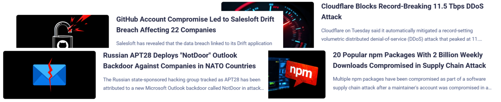
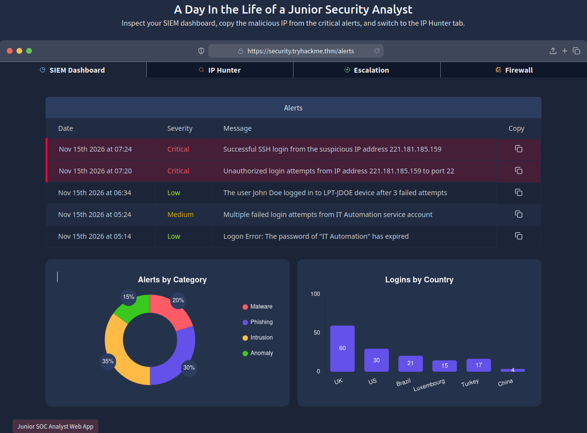

# Junior Security Analyst Intro

> **My simple takeaway:** A SOC L1 Analyst is one of the first people to review security alerts. The goal is not just to process alerts quickly. It is to **understand what happened, whether it matters, and what to do next**.

## 01 · Why does a company need a SOC?



Threats come in different forms: **DDoS** can disrupt services, account compromise can expose data, and attackers can exploit trusted software or accounts. A **Security Operations Center (SOC)** combines people, processes, and tools to **detect, investigate, and coordinate a response** to those risks.

Many SOCs operate **24/7**, with analysts working in shifts.

## 02 · What does an L1 shift look like?

I think of the job as four recurring tasks:

1. **Receive alerts:** Watch alerts from a SIEM and other security tools.
2. **Check context:** Review logs, IPs, accounts, timestamps, and affected hosts.
3. **Assess:** Is this normal activity, a false positive, or something that needs more investigation?
4. **Document and decide:** Update the ticket; close with supporting evidence, investigate further, or **escalate** when needed.


> [!FIGURE] Follow the evidence, not just the arrows
> **Sources → detection:** Endpoints, servers and network devices produce logs. A detection rule uses selected events or patterns to create an alert; that alert still needs validation.
>
> **Detection → triage:** Check the raw record, affected account and host, time window and expected activity. A rule name or severity label is a starting point, not the conclusion.
>
> **Three possible outcomes:** Close expected activity with a reason; keep investigating or escalate an unclear case; coordinate a response when the evidence warrants it and the runbook authorizes it.
>
> ==Missing evidence is not evidence of safety.== Record what could not be checked so the next analyst knows where to continue.

*Typical outcomes: close with evidence, investigate/escalate, or coordinate an authorized response. Not every alert is an incident.*

**Remember:** `Alert ≠ Incident`. An alert **does not prove** a security incident occurred.

### Three questions before acting

When I see an alert, I ask: **What does it report? What evidence supports it? What am I authorized to do next?** This prevents me from treating a **Critical** label as proof of an incident. Severity is a system-assigned priority signal; conclusions still require evidence and context.

## 03 · Who is on the SOC team?

| Role | What I need to know |
| --- | --- |
| **SOC Analyst L1** | Performs first-line alert triage and checks. |
| **Senior Analyst** | Helps with difficult cases and deeper investigations. |
| **SOC Engineer** | Configures and maintains the security tools. |
| **SOC Manager** | Coordinates SOC operations and reports outcomes. |
| **Incident Responder** | Handles incidents that need specialized response. |

The simplest distinction: **Analysts investigate alerts; Engineers keep the tools running**. Exact responsibilities vary by organization.

## 04 · Reading a SIEM Dashboard



> [!FIGURE] Read the alert list before the charts
> **Reconstruct the order:** The list is displayed newest first. Read 07:20 before 07:24 when reconstructing the sequence.
>
> **Use precise fields:** Keep the source IP, event time and alert description in the ticket. The screenshot does not show which account or destination host belongs to either SSH alert.
>
> **Charts give context:** Category totals and login countries describe activity in this view. They do not establish who operated a session or whether a login was authorized.
>
> **About this screen:** It is the TryHackMe lab interface. The times and IP below are observations from this screenshot, not a live incident report.

Start with the **Alerts** table. The two **Critical** entries show:

- **07:20:** Unauthorized login attempts from `221.181.185.159` to **port 22** (commonly used for SSH).
- **07:24:** A **successful SSH login** from the **same IP**.


> [!FIGURE] A shared IP is a lead, not a verdict
> **Observed:** Both alerts name `221.181.185.159`; their displayed times are four minutes apart. One describes attempts against port 22, the other a successful SSH login.
>
> **Still unverified:** Whether they concern the same user and destination, and whether the successful login was expected. An arrow between the alerts illustrates a hypothesis; it does not prove causation.
>
> **Next checks:** Compare the original authentication records, account, host and authentication method. Check the time zone before joining records from different systems, then review activity after the successful login.
>
> Keep the distinction explicit: ==successful authentication ≠ confirmed account compromise==.

**Why care?** The alerts involve the same IP, four minutes apart. They justify investigation, but **do not prove** that an account was compromised.

I would check **which account**, **which destination host**, **what the authentication logs show**, and **what happened after login**. The screenshot does not establish whether the earlier login attempts and successful login involved the same account or host.

The **Alerts by Category** and **Logins by Country** charts provide a broader picture, but a country's login count **is not evidence of an attack by itself**.

### Observations are not conclusions

- **Observed:** Two alerts share a source IP four minutes apart; one reports a successful SSH login.
- **Unknown:** Whether the same account, destination host, or person was involved, and whether the login was authorized.
- **Next checks:** Compare original authentication logs, verify the account and destination host, and look for post-login activity. If data is missing, explicitly record **insufficient evidence**.

An IP reputation check in a tool such as *IP Hunter* can support triage, but IP reputation alone does not replace log and context validation.

If the activity remains suspicious or exceeds my authority, I escalate with evidence documented in the **ticket**. Actions such as blocking an IP at the firewall require the right authorization and procedure.

## 05 · Write a ticket someone else can continue

A useful ticket says more than “malicious IP”. It separates **what was observed**, **what remains unverified**, and **what happens next**. For example, using the dashboard above:

> **Observed:** At 07:20, unauthorized login attempts to port 22; at 07:24, a successful SSH login from the same IP `221.181.185.159`. Both alerts are labeled Critical.  
> **Assessment:** Suspicious activity, but not enough evidence to confirm account compromise.  
> **Next step:** Review SSH logs, account, destination host, and post-login activity; escalate as required by the runbook.

A **runbook** is an internal procedure describing approved checks and actions. Blocking an IP is part of the simulated lab; in real operations, do it only with supporting evidence and the appropriate authorization.

## 06 · Essential terms

- **SIEM:** Centralizes and analyzes security events to help generate alerts.
- **Log:** A record of an activity.
- **Alert:** A signal to check, not necessarily an incident.
- **Triage:** Initial sorting and prioritization of alerts.
- **Ticket:** Tracks evidence, assessment, and actions taken.
- **Escalation:** Hands a case to someone with the right expertise or authority.

> **The takeaway:** SOC L1 means **read the alert → understand context → check evidence → choose the next step**. An alert is not a reason to immediately block an IP.

## 07 · References

- [TryHackMe – Junior Security Analyst Intro](https://tryhackme.com/room/jrsecanalystintrouxo) — simulated lab on SOC roles and alert triage.
- [NIST SP 800-61 Rev. 3](https://csrc.nist.gov/pubs/sp/800/61/r3/final) — incident response recommendations; **not** a mandatory runbook for every SOC.

## 08 · Knowledge check

```quiz
{
  "title": "Knowledge check: SOC L1 reasoning",
  "questions": [
    {
      "id": "soc-l1-core",
      "question": "Which option best describes an L1 analyst’s responsibility when receiving an alert?",
      "options": [
        "Prioritize by severity, then act according to the alert label.",
        "Validate evidence and context, document findings, then act or escalate according to the runbook.",
        "Escalate only after an attack has been conclusively established.",
        "Block the source first to minimize response time, then investigate."
      ],
      "answer": 1,
      "explanation": "Severity is a prioritization signal. Triage requires evidence, documentation, and authorized decisions."
    },
    {
      "id": "alert-v-incident",
      "question": "An alert is marked Critical. What can you conclude from that label alone?",
      "options": [
        "The business impact is confirmed severe even though the cause is unknown.",
        "The attack likelihood is high enough to treat it as a confirmed incident.",
        "The alert deserves priority review; Critical does not confirm an incident.",
        "A poor IP reputation would make Critical sufficient proof of account compromise."
      ],
      "answer": 2,
      "explanation": "Severity is input to triage, not independent proof of impact or compromise."
    },
    {
      "id": "soc-roles",
      "question": "An L1 analyst sees repeated false positives caused by a SIEM rule’s configuration. What is the best collaboration?",
      "options": [
        "Document alert patterns and work with the SOC Engineer to review or tune the detection.",
        "Send everything to Incident Response because false detections are incidents too.",
        "Ask the Senior Analyst to close each ticket; tuning is outside SOC responsibilities.",
        "Have the SOC Manager personally edit the rule because they own SOC performance."
      ],
      "answer": 0,
      "explanation": "Engineers commonly maintain detection tooling; analysts provide case evidence and context for tuning."
    },
    {
      "id": "ssh-alerts",
      "question": "The dashboard shows SSH alerts at 07:20 and 07:24 from the same IP. What is best supported?",
      "options": [
        "The 07:24 login definitely succeeded because of the attempts at 07:20.",
        "The alerts are linked by IP and time, but the account and destination host are not verified.",
        "Critical severity on both alerts confirms successful brute force.",
        "The word “unauthorized” confirms the successful login was unauthorized too."
      ],
      "answer": 1,
      "explanation": "The screenshot shows alerts, times, and a shared source IP; it does not establish causality or authorization of the successful login."
    },
    {
      "id": "triage-next-step",
      "question": "What is most useful for testing whether the two SSH alerts reflect the same attack sequence?",
      "options": [
        "Check IP reputation and login country; if both match, confirm the attack.",
        "Look at category charts to see whether intrusion alerts are trending upward.",
        "Review account, destination host, raw SSH logs, and post-login activity.",
        "Block the IP first to avoid losing evidence, then validate the relationship."
      ],
      "answer": 2,
      "explanation": "Account, destination, authentication chronology, and post-login context test the hypothesis; summary charts are not enough."
    },
    {
      "id": "reputation",
      "question": "IP Hunter rates 221.181.185.159 as high-risk. How should that affect your assessment?",
      "options": [
        "It identifies the person who logged in as an attacker.",
        "It proves the successful SSH session was a compromise.",
        "It removes the need to inspect raw authentication records.",
        "It raises suspicion and investigation priority, but logs and context still need validation."
      ],
      "answer": 3,
      "explanation": "IP reputation supports prioritization but does not prove the identity, actions, or outcome of a specific SSH session."
    },
    {
      "id": "ticket-contents",
      "question": "Which ticket would best help a Senior Analyst continue this investigation?",
      "options": [
        "“Critical SSH — malicious IP, please block” with a dashboard screenshot.",
        "“07:20 login attempts; 07:24 successful SSH from same IP; account/host unverified; check authentication logs” with evidence.",
        "“Might be brute force”, omitting timestamps because the SIEM has them.",
        "“Bad IP reputation, confirmed takeover”, asking for urgent containment."
      ],
      "answer": 1,
      "explanation": "The ticket should distinguish observed facts, evidence gaps, and next steps instead of presenting a hypothesis as a verdict."
    },
    {
      "id": "authorized-action",
      "question": "SSH activity remains suspicious, but L1 lacks permission to block IPs. What is the right next step?",
      "options": [
        "Block immediately because Critical severity overrides authorization.",
        "Close the alert because no incident is confirmed.",
        "Document evidence, report/escalate by runbook, and recommend containment for an authorized person to decide.",
        "Wait for another alert from the same IP before creating a ticket."
      ],
      "answer": 2,
      "explanation": "Response actions depend on evidence, risk, and authorization; L1 can recommend or escalate without taking unauthorized action."
    }
  ]
}
```
