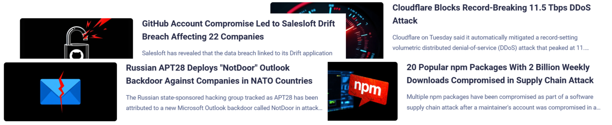
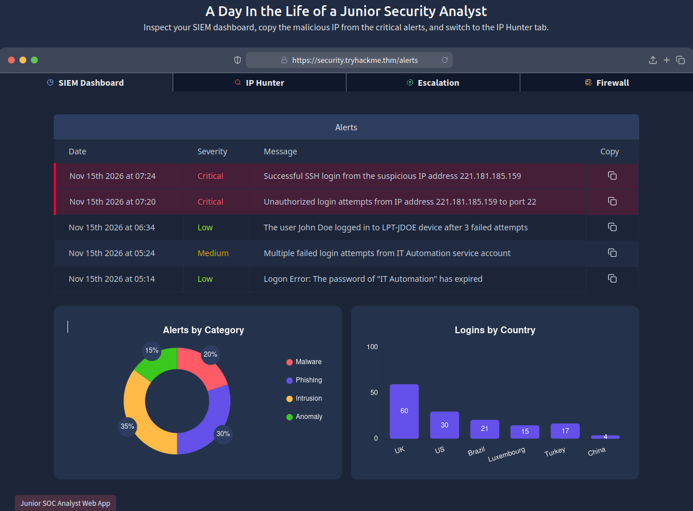

# Junior Security Analyst Intro

> **Mình hiểu đơn giản:** SOC Analyst L1 là người kiểm tra cảnh báo bảo mật ở tuyến đầu. Việc quan trọng không phải là xử lý càng nhiều alert càng tốt, mà là **hiểu chuyện gì xảy ra, có nguy hiểm không và nên làm gì tiếp**.

## 01 · Vì sao công ty cần SOC?



Các cuộc tấn công không chỉ có một kiểu: có vụ làm dịch vụ ngừng hoạt động (**DDoS**), có vụ đánh cắp dữ liệu, cũng có vụ lợi dụng phần mềm hoặc tài khoản đã bị xâm nhập. **SOC (Security Operations Center)** là nhóm kết hợp con người, quy trình và công cụ để **phát hiện sớm, điều tra và phối hợp ứng phó** với những nguy cơ đó.

Nhiều SOC hoạt động **24/7**, nên Analyst thường làm việc theo ca.

## 02 · Một ca trực SOC L1 diễn ra thế nào?

Mình hình dung công việc theo bốn việc chính:

1. **Nhận alert:** Theo dõi cảnh báo từ SIEM và các công cụ bảo mật.
2. **Kiểm tra:** Xem log, IP, tài khoản, thời gian và máy liên quan.
3. **Đánh giá:** Đây là hoạt động hợp lệ, cảnh báo sai hay dấu hiệu cần điều tra thêm?
4. **Ghi nhận và quyết định:** Cập nhật ticket; đóng khi có đủ căn cứ, tiếp tục điều tra hoặc **escalate** khi cần.


> [!FIGURE] Đi theo bằng chứng, không chỉ theo mũi tên
> **Nguồn log → phát hiện:** Máy trạm, máy chủ và thiết bị mạng tạo ra bản ghi. Quy tắc phát hiện dùng sự kiện hoặc mẫu hoạt động để tạo alert; alert đó vẫn cần được kiểm chứng.
>
> **Phát hiện → triage:** Xem bản ghi gốc, tài khoản, máy liên quan, khoảng thời gian và hoạt động dự kiến. Tên quy tắc hay nhãn severity là điểm bắt đầu, không phải kết luận.
>
> **Ba hướng xử lý:** Đóng hoạt động hợp lệ kèm căn cứ; tiếp tục điều tra hoặc chuyển cấp khi chưa rõ; phối hợp ứng phó khi có bằng chứng và được runbook cho phép.
>
> ==Thiếu bằng chứng không đồng nghĩa với an toàn.== Ghi rõ điều chưa kiểm tra được để người nhận bàn giao biết cần tiếp tục ở đâu.

*Ba hướng xử lý thường gặp: đóng có căn cứ, điều tra/chuyển cấp hoặc phối hợp ứng phó theo đúng quyền hạn. Không phải alert nào cũng là incident.*

**Nhớ nhanh:** `Alert ≠ Incident` — có cảnh báo **chưa có nghĩa** đã xảy ra sự cố bảo mật.

### Ba câu hỏi trước khi xử lý

Khi thấy một alert, mình tự hỏi: **Nó báo điều gì? Có bằng chứng nào hỗ trợ? Mình được phép làm gì tiếp?** Cách nghĩ này giúp tránh nhầm mức **Critical** với một sự cố đã được xác nhận. Severity cho biết mức độ ưu tiên do hệ thống gán, còn kết luận phải dựa trên dữ liệu và bối cảnh.

## 03 · Mình làm việc cùng ai?

| Vị trí | Mình cần hiểu |
| --- | --- |
| **SOC Analyst L1** | Kiểm tra và phân loại cảnh báo ban đầu. |
| **Senior Analyst** | Hỗ trợ các trường hợp khó, điều tra sâu hơn. |
| **SOC Engineer** | Cấu hình và duy trì công cụ bảo mật. |
| **SOC Manager** | Điều phối hoạt động và theo dõi kết quả của nhóm. |
| **Incident Responder** | Ứng cứu khi có sự cố cần xử lý chuyên sâu. |

Dễ phân biệt nhất: **Analyst phân tích cảnh báo; Engineer duy trì công cụ**. Trách nhiệm cụ thể có thể khác nhau giữa các tổ chức.

## 04 · Thử đọc một SIEM Dashboard



> [!FIGURE] Đọc bảng cảnh báo trước các biểu đồ
> **Dựng lại thứ tự thời gian:** Danh sách đang xếp bản ghi mới lên trên. Khi dựng lại chuỗi sự kiện, đọc mốc 07:20 trước mốc 07:24.
>
> **Giữ đúng trường dữ liệu:** Ghi IP nguồn, thời điểm và mô tả alert vào ticket. Ảnh chưa cho biết tài khoản và máy đích của từng cảnh báo SSH.
>
> **Biểu đồ chỉ bổ sung bối cảnh:** Tỷ lệ loại cảnh báo và quốc gia đăng nhập mô tả hoạt động trong khung nhìn này. Chúng không xác định người thực hiện hay tính hợp lệ của một phiên đăng nhập.
>
> **Bối cảnh của ảnh:** Đây là giao diện lab TryHackMe. Các mốc giờ và IP bên dưới được đọc từ ảnh này, không phải báo cáo về một sự cố đang diễn ra.

Đọc bảng **Alerts** trước. Hai dòng **Critical** cho biết:

- **07:20:** Có các lần thử đăng nhập trái phép từ `221.181.185.159` đến **port 22** (thường dùng cho SSH).
- **07:24:** Có một lần **đăng nhập SSH thành công** từ **cùng IP**.


> [!FIGURE] Cùng IP là đầu mối, chưa phải kết luận
> **Đã quan sát:** Hai alert đều ghi `221.181.185.159`, thời điểm hiển thị cách nhau bốn phút. Một alert nói về các lần thử vào port 22; alert còn lại nói có đăng nhập SSH thành công.
>
> **Chưa xác minh:** Có cùng tài khoản, cùng máy đích hay không, và lần đăng nhập thành công có nằm trong hoạt động được cho phép không. Mũi tên giữa hai alert minh họa giả thuyết, không chứng minh quan hệ nhân quả.
>
> **Kiểm tra tiếp:** Đối chiếu log xác thực gốc, tài khoản, máy đích và phương thức xác thực. Kiểm tra múi giờ trước khi ghép bản ghi từ nhiều hệ thống, rồi xem hoạt động sau lần đăng nhập thành công.
>
> Luôn tách rõ: ==xác thực thành công ≠ xác nhận tài khoản bị chiếm==.

**Vì sao đáng chú ý?** Hai alert liên quan cùng IP trong bốn phút. Đây là dấu hiệu đáng điều tra, **không phải bằng chứng chắc chắn** rằng một tài khoản đã bị chiếm.

Mình sẽ kiểm tra thêm: **tài khoản nào**, **máy đích nào**, **log xác thực ghi gì** và **sau khi đăng nhập đã làm gì**. Ảnh chưa cho biết các lần thử và lần thành công có cùng tài khoản hay cùng máy đích hay không.

Ngoài bảng alert, dashboard có biểu đồ **Alerts by Category** và **Logins by Country** để xem bối cảnh chung. Số lượt đăng nhập từ một quốc gia **không tự nó chứng minh** có tấn công.

### Quan sát khác với kết luận

- **Đã thấy:** Hai cảnh báo có cùng IP nguồn, cách nhau bốn phút; một cảnh báo nói có đăng nhập SSH thành công.
- **Chưa biết:** Có phải cùng tài khoản, cùng máy đích, cùng một người thực hiện hay không; đăng nhập có được cho phép không.
- **Cần làm:** Đối chiếu log gốc, xác minh tài khoản và máy đích, tìm hoạt động sau đăng nhập. Nếu dữ liệu thiếu, ghi rõ là **chưa đủ bằng chứng**.

Tra cứu uy tín của IP trong công cụ như *IP Hunter* có thể hỗ trợ điều tra, nhưng kết quả uy tín IP cũng không thay thế được việc kiểm tra log và bối cảnh.

Nếu kết quả kiểm tra vẫn đáng ngờ hoặc vượt quyền hạn, L1 chuyển cấp với bằng chứng đã ghi trong **ticket**. Những hành động như chặn IP trên firewall chỉ thực hiện theo quy trình và quyền được cấp.

## 05 · Ghi ticket để người khác tiếp tục được

Một ticket tốt không chỉ ghi “IP nguy hiểm”. Mình cần tách **điều đã quan sát**, **điều chưa xác minh** và **bước tiếp theo**. Ví dụ với ảnh dashboard ở trên:

> **Observed:** 07:20 có các lần thử đăng nhập trái phép vào port 22; 07:24 có đăng nhập SSH thành công từ cùng IP `221.181.185.159`. Cả hai alert được gắn Critical.  
> **Assessment:** Hoạt động đáng ngờ, nhưng chưa đủ dữ liệu để kết luận chiếm tài khoản.  
> **Next step:** Kiểm tra log SSH, tài khoản, máy đích và hoạt động sau đăng nhập; chuyển cấp nếu cần theo runbook.

**Runbook** là hướng dẫn nội bộ quy định những bước kiểm tra và xử lý được phép thực hiện. Trong bài lab, thao tác chặn IP là một phần mô phỏng; ngoài thực tế, mình chỉ chặn khi có căn cứ và đúng thẩm quyền.

## 06 · Từ khóa cần nhớ

- **SIEM:** Nơi tập trung và phân tích sự kiện để hỗ trợ phát hiện cảnh báo.
- **Log:** Bản ghi hoạt động.
- **Alert:** Tín hiệu cần kiểm tra; chưa chắc là sự cố.
- **Triage:** Sàng lọc và ưu tiên cảnh báo.
- **Ticket:** Phiếu ghi nhận bằng chứng, đánh giá và hành động đã thực hiện.
- **Escalation:** Chuyển trường hợp cho người có chuyên môn hoặc thẩm quyền phù hợp.

> **Chốt lại:** Công việc của SOC L1 là **đọc cảnh báo → hiểu bối cảnh → kiểm tra bằng chứng → quyết định bước tiếp theo**. Không phải thấy alert là lập tức chặn IP.

## 07 · Tài liệu đối chiếu

- [TryHackMe – Junior Security Analyst Intro](https://tryhackme.com/room/jrsecanalystintrouxo) — bài lab minh họa vai trò và thao tác phân loại cảnh báo.
- [NIST SP 800-61 Rev. 3](https://csrc.nist.gov/pubs/sp/800/61/r3/final) — khuyến nghị về ứng phó sự cố; dùng để hiểu bối cảnh, **không phải** quy trình bắt buộc cho mọi SOC.

## 08 · Tự kiểm tra

```quiz
{
  "title": "Tự kiểm tra: tư duy SOC L1",
  "questions": [
    {
      "id": "soc-l1-core",
      "question": "Khi tiếp nhận alert, lựa chọn nào phản ánh đúng nhất trách nhiệm của SOC L1?",
      "options": [
        "Ưu tiên alert dựa trên severity, sau đó quyết định hành động theo nhãn hệ thống.",
        "Xác minh dữ liệu và bối cảnh, ghi nhận bằng chứng rồi xử lý hoặc chuyển cấp theo runbook.",
        "Chỉ chuyển cấp những alert có dấu hiệu kỹ thuật chắc chắn của một cuộc tấn công.",
        "Tạm khóa nguồn liên quan trước, rồi điều tra để giảm thời gian phản ứng."
      ],
      "answer": 1,
      "explanation": "Severity chỉ giúp ưu tiên; L1 cần kiểm chứng, ghi lại căn cứ và hành động theo thẩm quyền."
    },
    {
      "id": "alert-v-incident",
      "question": "Một alert được gắn Critical. Kết luận nào có thể đưa ra chỉ từ thông tin này?",
      "options": [
        "Ảnh hưởng đã được xác nhận ở mức nghiêm trọng, nhưng chưa rõ nguyên nhân.",
        "Khả năng là tấn công cao nên có thể xem là incident để chuyển thẳng IR.",
        "Đây là tín hiệu cần ưu tiên đánh giá; mức Critical chưa xác nhận incident.",
        "Nếu IP có uy tín xấu thì Critical đủ để xác nhận tài khoản bị chiếm."
      ],
      "answer": 2,
      "explanation": "Nhãn severity là đầu vào của triage, không phải bằng chứng độc lập về tác động hay xâm nhập."
    },
    {
      "id": "soc-roles",
      "question": "L1 thấy một quy tắc SIEM liên tục tạo false positive vì cấu hình. Phối hợp nào phù hợp nhất?",
      "options": [
        "Ghi lại mẫu cảnh báo và phối hợp SOC Engineer để kiểm tra/tinh chỉnh quy tắc.",
        "Chuyển hết cho Incident Responder vì phát hiện sai cũng là một incident.",
        "Chỉ nhờ Senior Analyst đóng từng ticket; việc chỉnh quy tắc không thuộc SOC.",
        "Để SOC Manager trực tiếp sửa quy tắc vì họ phụ trách chất lượng hoạt động."
      ],
      "answer": 0,
      "explanation": "Engineer thường phụ trách cấu hình và vận hành công cụ; Analyst cung cấp bối cảnh và mẫu cảnh báo để cải thiện chất lượng phát hiện."
    },
    {
      "id": "ssh-alerts",
      "question": "Dashboard có alert SSH lúc 07:20 và 07:24 từ cùng IP. Kết luận nào được dữ liệu hỗ trợ tốt nhất?",
      "options": [
        "Đăng nhập lúc 07:24 chắc chắn thành công nhờ các lần thử lúc 07:20.",
        "Hai alert liên quan về IP và thời gian, nhưng chưa xác nhận cùng tài khoản hay máy đích.",
        "Đây là brute-force thành công nếu cả hai alert đều mang severity Critical.",
        "Đã xác nhận có truy cập trái phép vì hệ thống dùng chữ “unauthorized”."
      ],
      "answer": 1,
      "explanation": "Ảnh chỉ cung cấp mô tả alert, thời điểm và IP; không đủ để xác nhận quan hệ nhân quả hay tính hợp pháp của lần đăng nhập."
    },
    {
      "id": "triage-next-step",
      "question": "Nếu muốn xác minh hai alert SSH có nằm trong cùng một chuỗi tấn công hay không, bước nào có giá trị nhất?",
      "options": [
        "Đối chiếu IP reputation và quốc gia đăng nhập; nếu trùng là có thể kết luận.",
        "Kiểm tra số lượng alert theo danh mục để xem intrusion đang tăng hay giảm.",
        "Xem tài khoản, máy đích, bản ghi SSH gốc và hoạt động sau đăng nhập.",
        "Chặn IP trước để tránh mất dữ liệu, rồi mới xác minh mối liên hệ."
      ],
      "answer": 2,
      "explanation": "Phải xác định đúng đối tượng, đích, thứ tự xác thực và hoạt động tiếp theo; các chỉ số tổng quan chỉ giúp bổ sung bối cảnh."
    },
    {
      "id": "reputation",
      "question": "IP Hunter đánh giá IP 221.181.185.159 có rủi ro cao. Điều đó thay đổi nhận định ra sao?",
      "options": [
        "Xác nhận danh tính người đăng nhập là kẻ tấn công.",
        "Đủ để coi lần đăng nhập thành công là compromise.",
        "Không còn cần mở bản ghi xác thực gốc vì nguồn IP đã bị gắn nhãn.",
        "Tăng mức đáng nghi và ưu tiên điều tra, nhưng vẫn cần xác minh theo log và bối cảnh."
      ],
      "answer": 3,
      "explanation": "Uy tín IP là một tín hiệu bổ trợ, không chứng minh hành vi, danh tính hoặc tác động của phiên SSH cụ thể."
    },
    {
      "id": "ticket-contents",
      "question": "Ticket nào giúp Senior Analyst tiếp tục điều tra tốt nhất?",
      "options": [
        "“Critical SSH — malicious IP, đề nghị block” kèm ảnh dashboard.",
        "“07:20 có login attempts; 07:24 có successful SSH từ cùng IP; chưa xác minh account/host; cần đối chiếu auth log” kèm chứng cứ.",
        "“Có thể bị brute force”, không nêu timestamp vì đã có trên SIEM.",
        "“IP có reputation xấu, case xác nhận bị chiếm” và yêu cầu xử lý ngay."
      ],
      "answer": 1,
      "explanation": "Ticket cần nêu dữ liệu quan sát, giới hạn bằng chứng và bước tiếp theo, không trình bày giả thuyết như kết luận."
    },
    {
      "id": "authorized-action",
      "question": "Sau khi kiểm tra, hoạt động SSH vẫn đáng nghi nhưng L1 chưa được cấp quyền chặn IP. Cách xử lý phù hợp?",
      "options": [
        "Chặn ngay vì mức độ Critical quan trọng hơn phân quyền.",
        "Đóng alert do chưa có xác nhận incident.",
        "Ghi bằng chứng, báo cáo/chuyển cấp theo runbook và đề xuất biện pháp để người có quyền quyết định.",
        "Đợi thêm một alert khác từ cùng IP rồi mới ghi ticket."
      ],
      "answer": 2,
      "explanation": "Biện pháp ứng phó phải phù hợp bằng chứng, mức rủi ro và quyền hạn; L1 có thể đề xuất hoặc chuyển cấp mà không tự ý chặn."
    }
  ]
}
```
